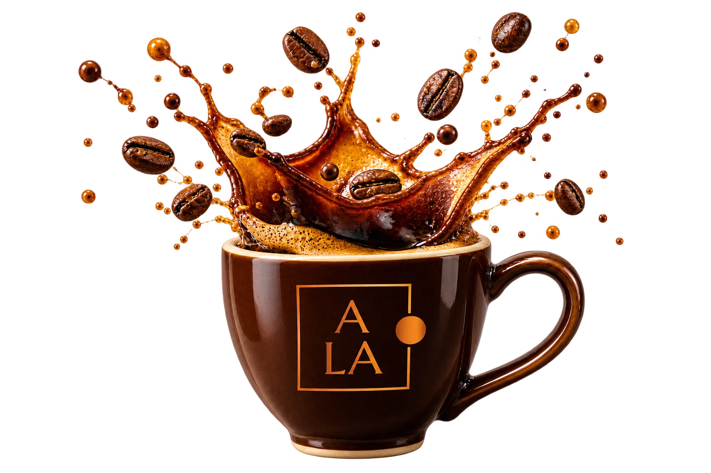
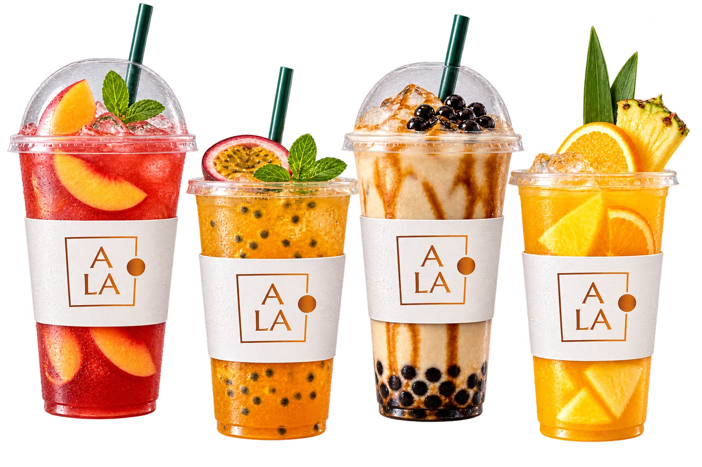

# Ala Coffee

Landing page tĩnh bằng HTML, CSS và JavaScript thuần, sẵn sàng triển khai lên Cloudflare Pages.

## Nhận diện Ala

Logo SVG và favicon được dựng theo ảnh tham chiếu khách hàng cung cấp: chữ A/LA, khung vuông hở và chấm tròn, chuyển sắc đồng cam trên nền trắng. Giao diện sử dụng trắng `#FFFFFF`, đồng `#A65320`, cam `#EDA03C`, nâu `#532D1C` và nền phụ `#FAF5EF`; giữ Cormorant Garamond cho tiêu đề và Be Vietnam Pro cho nội dung.

Ba ảnh sản phẩm đã được cập nhật nhận diện Ala bằng công cụ imagegen tích hợp, lưu PNG gốc và WebP có alpha trong `assets/images/`. Xem [prompt và tài sản ảnh](assets/images/README.md).

## Hình ảnh giới thiệu

Ala Coffee — Art & Espresso giới thiệu câu chuyện thương hiệu, menu đồ uống và trải nghiệm cà phê tại Yên Phong, Bắc Ninh. Một vài hình ảnh minh họa được sử dụng trên website:

### Espresso — cảm hứng chủ đạo

### Khám phá đồ uống

| Đồ uống đặc trưng | Đồ uống mát lạnh |
| :---: | :---: |
|  |  |

## Chạy cục bộ

Mở `index.html` trực tiếp hoặc chạy một static server bất kỳ tại thư mục gốc.

## Cloudflare Pages

- Framework preset: `None`
- Build command: để trống
- Build output directory: `/`

## Nội dung cần cập nhật

- Thay trạng thái Zalo khi có đường dẫn chính thức.
- Kiểm tra lại tên và nội dung cảm nhận khách hàng trước khi xuất bản thương mại.
- Thêm URL production vào metadata `og:url` sau khi có tên miền hoặc địa chỉ Pages.

## Âm thanh

Website thử phát nhạc tự động khi tải. Nếu chính sách autoplay của trình duyệt chặn âm thanh, nhạc sẽ bắt đầu ở tương tác đầu tiên của khách trên trang; nút âm thanh trên hero và header luôn cho phép phát hoặc tạm dừng.
